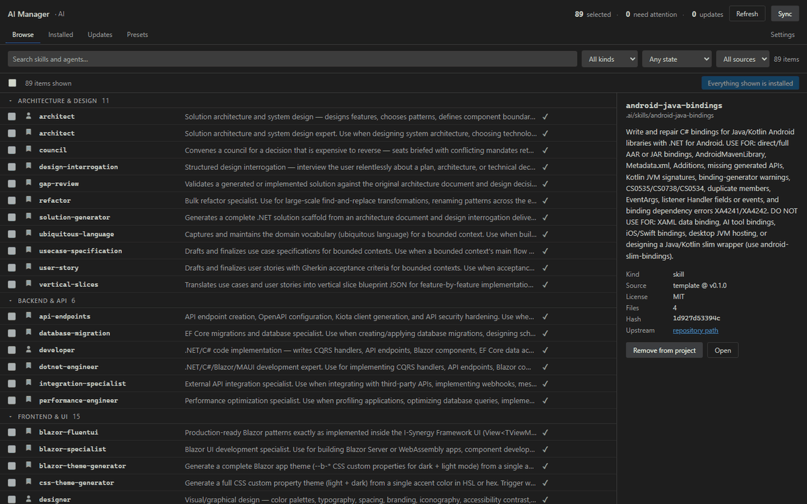
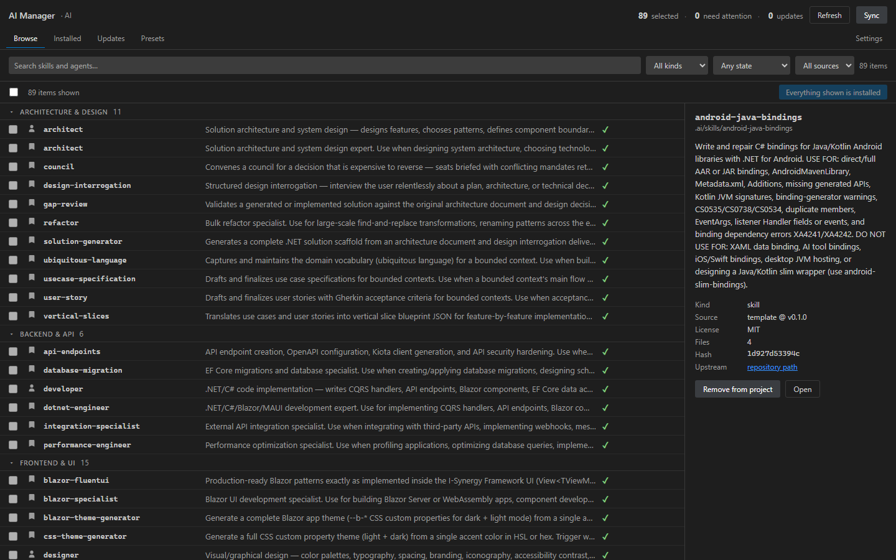
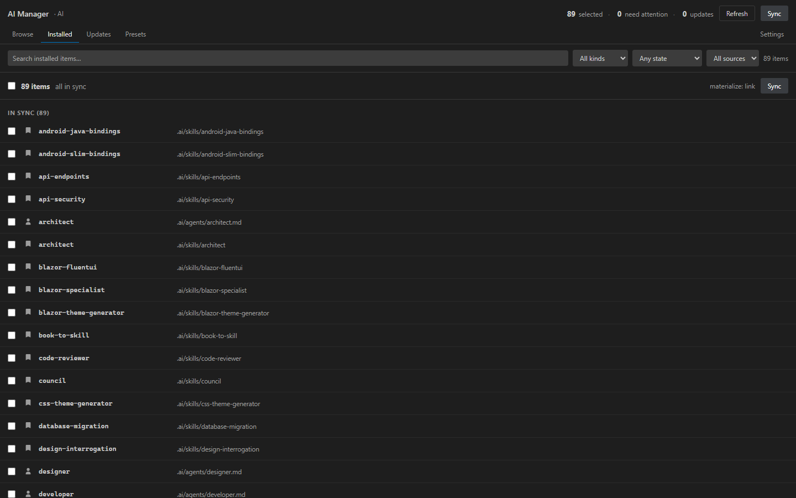
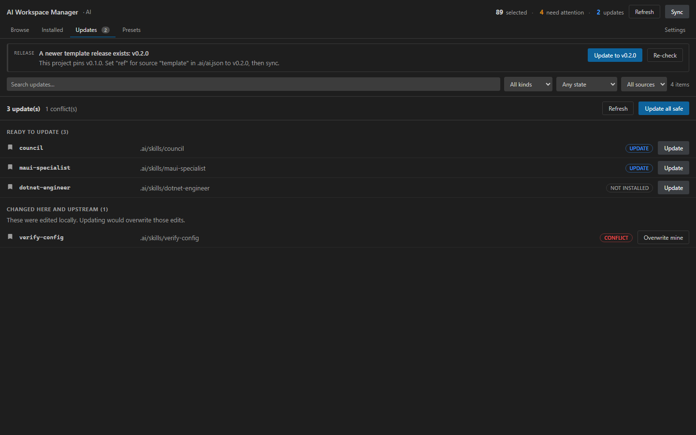
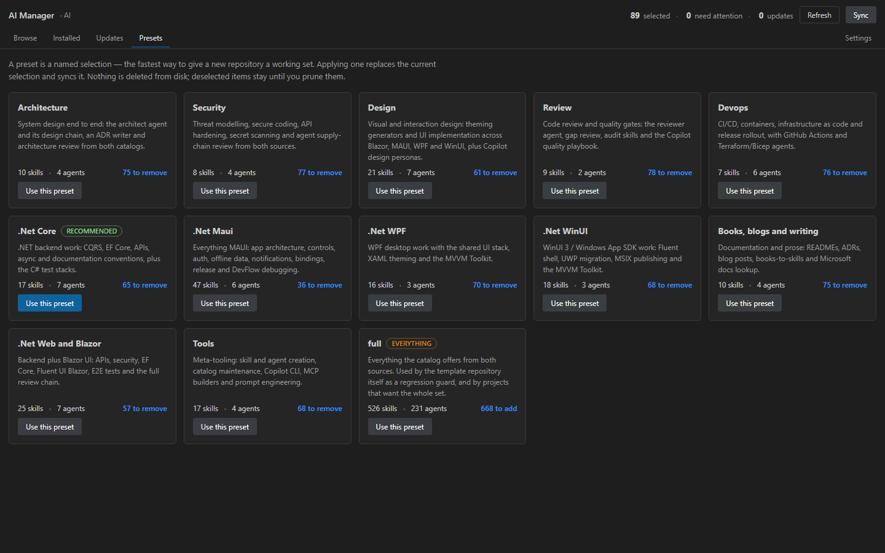
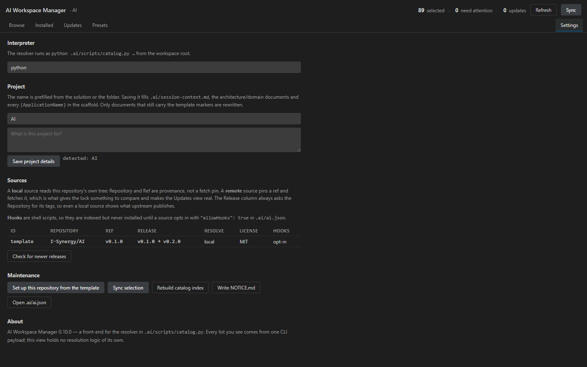

# AI Workspace Manager for VS Code

A full-page manager for the skills, agents, instructions and prompts each repository installs. The
catalog comes from [I-Synergy/AI](https://github.com/I-Synergy/AI),
[github/awesome-copilot](https://github.com/github/awesome-copilot) and
[dotnet/maui-labs](https://github.com/dotnet/maui-labs); see
[Sources](#sources). It ships the per-repository resolver, so a repository
installs **only** what it selected, and updates are a diff against a pinned
revision rather than a re-clone.

## The problems this solves

Copilot, Claude Code and Reasonix/DeepSeek only follow the skills, agents,
instructions and prompts that are present in the repository. Getting that content there by
hand is where teams lose time:

- **All-or-nothing adoption.** Cloning a template brings every skill and agent,
  including the ones a project will never use. There is no per-repository
  selection, and no dependency closure when you do select.
- **Silent drift.** Installed files get edited in place. A later template update
  either overwrites that work or is skipped; nobody can tell which files are
  template-owned, which the project changed, or which are stale.
- **No provenance.** It is hard to answer where an item came from, which revision
  it was installed from, its licence, or whether upstream has moved.
- **Sources do not compose.** The template catalog, `awesome-copilot`, the two
  MAUI Labs sources and `aspire-skills` overlap; duplicates, name collisions and
  missing requirements surface only after install.
- **Setup is manual.** A new repository needs the resolver, vocabulary,
  `AGENTS.md`, Copilot instructions, Claude settings, project folders and the
  `.claude` / `.github` / `.reasonix` junctions — often by running several scripts.
- **Updates are risky.** Without a lock and content hashes, an update is a
  re-clone that can delete local changes, and removal has no explicit boundary.

AI Workspace Manager makes a repository's selection a first-class, reviewable thing: one
catalog over all sources, a per-repository selection, a lock with content
hashes, and updates that are a diff against a pinned revision.

| Problem | What the extension does |
|---|---|
| Choosing what to install | Browse all sources, filter, bulk-select, and apply presets with dependencies resolved |
| Keeping it current | Compares the pinned ref with the source's release tags and offers a one-click upgrade to the newest release |
| Protecting local work | `local-modified` / `upstream-changed` / `conflict` states; nothing is overwritten without an explicit choice |
| Knowing what is installed | Installed view grouped by health, with provenance, path, licence and install mode |
| Setting up a repository | First activation writes the resolver, vocabulary, `AGENTS.md`, Copilot/Claude configuration, project folders and platform junctions |
| Removing safely | Removing edits the selection; files leave disk only through an explicit prune |
| Working without a manifest | An implicit starter resolves the repository's own tree or the template, so Browse and Installed work immediately |

## What it does

| Surface | What it does |
|---|---|
| **Browse** | The whole catalog: search, filter by kind / source / state, detail pane with provenance. Tick rows that are not installed yet (already-installed rows are disabled — manage those in Installed) for a bulk install that works across filters, or install everything the current filter matches |
| **Installed** | What this repo has, grouped by state — needs attention first. Search and filter by kind / source / health (in sync, needs attention, not materialised), tick rows to remove several at once, plus sync, per-item **lock** (freeze edited content so update and sync never overwrite it), remove and prune for deselected leftovers |
| **Updates** | Items whose catalog content moved upstream, with the four states (unchanged / upstream-changed / modified here / conflict) and *update all safe* — plus search and kind / source / ready-vs-conflict filters, and a banner when the pinned ref is older than the source's newest release tag |
| **Presets** | Named selections that compose: adding one keeps every other preset and anything picked individually, and each card says exactly how many items it would add. Fourteen domain presets, alphabetical (Architecture, Aspire, Books & writing, Design, Devops, .NET Core / MAUI / Web & Blazor / WinUI / WPF, Review, Security), with **Tools** at 13, **Minimal** at 14 and **Everything** last; drawing on all four repositories, dependencies resolved |
| **Settings** | Interpreter, project name/intention, **AI clients** (Claude Code default; Copilot and Reasonix opt-in), sources table (repo / ref / release / resolve / licence / hooks), maintenance actions |

Plus a status-bar-style launcher view in the Explorer with a drift badge, and
command-palette entries: Open, Select Skills and Agents, Check for Updates,
Sync Selection.

## Sources

The skills, agents, instructions and prompts are not written into this extension. They
live in four open-source repositories, and a project installs the ones it
selects, pinned to a revision:

| Source id | Repository | Licence | What it provides |
|---|---|---|---|
| `template` | [I-Synergy/AI](https://github.com/I-Synergy/AI) | MIT | The skill, agent, instruction, prompt, plugin and hook catalog this extension is built around, plus the resolver (`.ai/scripts/`), vocabulary (`.ai/catalog/`) and schemas that the `tooling/` snapshot vendors |
| `awesome-copilot` | [github/awesome-copilot](https://github.com/github/awesome-copilot) | MIT | Community-contributed instructions, agents, skills and configurations for GitHub Copilot, offered as a built-in third-party source |
| `aspire-skills` | [microsoft/aspire-skills](https://github.com/microsoft/aspire-skills) | MIT | Official Aspire skills for initializing, wiring, orchestrating, monitoring and deploying distributed apps |
| `dotnet-maui` | [dotnet/maui-labs](https://github.com/dotnet/maui-labs) | MIT | MAUI app, desktop-backend and native-binding skills from that repository's `dotnet-maui` plugin, plus its agents and instructions |
| `dotnet-maui-tooling` | [dotnet/maui-labs](https://github.com/dotnet/maui-labs) | MIT | DevFlow, workload and binding-tooling skills from that repository's `dotnet-maui-tooling` plugin |

Setup writes all five sources into `.ai/ai.json`, so the origin of every item is
reviewable in a diff:

```jsonc
"sources": {
  "template":   { "repo": "I-Synergy/AI",           "ref": "main", "resolve": "remote" },
  "aspire-skills": { "repo": "microsoft/aspire-skills", "ref": "main", "resolve": "remote", "license": "MIT" },
  "awesome-copilot": { "repo": "github/awesome-copilot", "ref": "main", "resolve": "remote", "license": "MIT" },
  "dotnet-maui": { "repo": "dotnet/maui-labs", "ref": "main", "resolve": "remote", "license": "MIT",
                   "paths": {
                     "skill":       ["plugins/dotnet-maui/skills"],
                     "agent":       [".github/agents"],
                     "instruction": [".github/instructions"],
                     "plugin": [], "hook": []
                   } },
  "dotnet-maui-tooling": { "repo": "dotnet/maui-labs", "ref": "main", "resolve": "remote", "license": "MIT",
                   "paths": {
                     "skill": ["plugins/dotnet-maui-tooling/skills"],
                     "agent": [], "instruction": [], "plugin": [], "hook": []
                   } }
}
```

Most sources keep each kind at `skills/`, `agents/` or `instructions/` at the
repository root. `paths` exists for a repository like MAUI Labs that nests its
items: every listed directory is read, an empty list disables that kind, and the
Browse detail pane shows the real `sourcePath` (for example
`plugins/dotnet-maui/skills/maui-performance`).

Prompts are read from `prompts/` (`.prompt.md`, or plain `.md`) and installed
under `.ai/prompts/`. Instructions and prompts are mirrored to
`.claude/instructions/` + `.github/instructions/` and `.claude/commands/` +
`.github/prompts/` respectively, like the skill and agent junctions.

[I-Synergy/AI](https://github.com/I-Synergy/AI) is the upstream project: pinning
its `ref` to a release tag (for example `v1.6.0`) is what lets the Updates view
compare against newer releases — see [Requirements](#requirements). Each item
keeps its source, pinned `ref`, licence and content hash in `.ai/ai.lock.json`,
and the Browse detail pane shows the same provenance. Licence notices for the
assets bundled in the VSIX travel in [`NOTICE`](NOTICE); the catalog content
itself is MIT.

## Install

Search for **AI Workspace Manager for VS Code** in the Extensions view, or:

```bash
code --install-extension I-Synergy.aiworkspacemanager
```

Open a folder and the extension sets up `.ai/` on first activation — the
resolver, the vocabulary and the agent configuration. A brand-new project always
gets the template's supporting folders too (plans, patterns, reference, …).
Existing files are never overwritten or removed; **Add template folders** /
`catalog.py scaffold` copies only what is missing.

New projects use **Claude Code by default**. Copilot and Reasonix are opt-in
under **Settings → Clients**; each client gets junction folders over the same
`.ai/` content, and disabling one removes only its junctions and generated
instructions (never real project files or `.github/workflows`).

## Screenshots



| Browse | Installed |
|---|---|
|  |  |
| **Updates** | **Presets** |
|  |  |
| **Settings** | |
|  | |

## Design decisions

- **The CLI is the only implementation.** Every list the webview renders comes
  from one `catalog.py --json` call. The extension holds no resolution logic, so
  it cannot drift from what CI enforces (`sync --check`, `index --verify`).
- **Loud about cost.** The resolver exists because 530 installed skills is
  noise. Presets are recommended, `Everything` is never the default but never hidden,
  and the delta on every card says exactly how many items it would add.
- **Nothing destructive by default.** Removing edits `.ai/ai.json` only; files
  leave disk only through an explicit Prune, which says so on the button. Prune
  deletes every lock-recorded item not in the current selection, so run it
  deliberately. The current resolver preserves lock entries for kinds it does
  not know; an older client does not, so upgrade before pruning a project that
  uses newer kinds such as prompts.
- **The template owns its resolver; the project owns everything else.**
  Setup writes the whole `.ai/scripts/` set (resolver, mirrors, hygiene,
  migration, upgrade), the vocabulary under `.ai/catalog/`, and the agent
  configuration, recording provenance in `.ai/tooling.json`. A file the template
  no longer ships is filled from the extension's bundled copy. Template files
  are refreshed only on an explicit update-to-release; a file the project
  created, or a template file edited after install, is never overwritten by a
  later update. The supporting `.ai/` folders are created for a new project and
  never overwritten or pruned afterwards; `scaffold` only fills in missing
  files.
- **State is two small JSON files.** `.ai/ai.json` is the selection;
  `.ai/ai.lock.json` records what was materialised (id, ref, hash, path, mode).
  Per-item marker files from older versions are no longer written and are
  cleaned on the next sync. The generated catalog index is a local cache under
  `.ai/tmp/`, never committed.
- **Native in every theme.** Styling uses only `--vscode-*` variables, so light,
  dark and high-contrast all work without a single hard-coded colour.

## Requirements

- Any folder. On first activation AI Workspace Manager sets it up from the template:
  `.ai/ai.json`, the resolver and vocabulary under `.ai/` (`.ai/scripts/`,
  `.ai/catalog/`), and the agent configuration: `AGENTS.md`,
  `.github/copilot-instructions.md`, `.claude/settings.json` and
  `.gitattributes`. A brand-new project also gets the supporting folders an
  agent expects — `analysis`, `checklists`, `completed`, `patterns`, `plans`,
  `progress`, `project`, `reference` and `session-context.md` — once; an
  existing project is not re-seeded. Nothing project-owned is overwritten or
  removed; the same setup can be re-run from Settings. On an existing project, setup also
  adds any newly offered third-party source to `.ai/ai.json`, leaving the
  selection untouched.
- Python on `PATH`, or set `aiManager.pythonPath`. The resolver itself ships
  inside the VSIX.

For updates to be meaningful, the source must resolve remotely:

```jsonc
"sources": {
  "template": { "repo": "I-Synergy/AI", "ref": "v1.6.0", "resolve": "remote" }
}
```

With `"resolve": "local"` (the default) the source is the project's own tree, so
there is no upstream to compare — the Updates view explains exactly this instead
of pretending there is nothing to do.

Release detection is independent of that: `release` asks the source's repository
for its tags (`git ls-remote`, read-only, no clone) and compares them with the
pinned `ref` as semantic versions. A branch or SHA pin has nothing to compare,
so it is reported without a "newer" claim. Bumping the pin stays a manifest edit
— the banner tells you which one.

## Develop

```bash
npm install
npm run compile        # tsc --noEmit, strict
npm test               # pure-logic unit tests (node --test)
npm run test:resolver  # resolver tests (pytest, test/resolver)
npm run build          # esbuild: dist/extension.js, dist/web.js, dist/web.css
npm run dev            # build, then serve the real webview in a browser
```

`npm run dev` serves the actual bundle against fixtures from `tools/fixtures/`,
so the UI can be reviewed and screenshotted without VS Code:

- `http://localhost:3731/` — populated repository, dark theme
- `?theme=light` — light theme
- `?scenario=empty` — a brand-new repository, the install-everything starting point

The fixtures are generated from the real resolver
(`catalog.py browse --json`), so the screenshots show real catalog content.

## Layout

```
src/common/     types shared by both sides + the typed RPC layer
src/host/       activation, full-page panel, HostAPI (shells out to catalog.py)
src/web/        Lit components, store, router, logic.ts (pure, unit-tested)
tools/          dev harness: index.html, mock-api.js, dev-server.mjs, fixtures
tooling/        committed resolver snapshot the VSIX runs (see Packaging)
test/           pure-logic tests (node) + test/resolver/ (pytest)
scripts/        sync-tooling (snapshot) + install-tooling (vendor into a repo)
```

`src/web/logic.ts` holds all parsing, filtering, grouping and delta maths and
imports nothing from `vscode` or `lit`, which is what makes it testable without
an editor host — the same reason the reference NuGet manager splits `src/web`
from `src/host`.

## Packaging

```bash
npm run package   # -> releases/aiworkspacemanager-<version>.vsix
```

`.vscodeignore` keeps the bundle to the compiled output; the CI workflow asserts
the VSIX stays under 2 MB so a leaked `node_modules` cannot slip through.

## Publishing

The Marketplace release uses the same flow as NuGet Package Manager: a push of a
new version to the default branch publishes it, tags `v<version>` and creates a
GitHub Release with the `.vsix`.

1. Add the `VSCE_PAT` repository secret (Marketplace → **Manage** scope for the
   `I-Synergy` publisher).
2. Run **Actions → Release → Run workflow** and pick `patch`, `minor` or `major`.
   `tools/release.mjs` bumps `package.json` and `package-lock.json`, moves the
   `CHANGELOG.md` entries under Unreleased into the new version, writes
   `RELEASE_NOTES.md`, then commits and pushes.
3. CI builds and tests; the publish job publishes `I-Synergy.aiworkspacemanager`, tags
   the commit and attaches `aiworkspacemanager.vsix` to the GitHub Release.

Publishing is skipped when the version's `v<version>` tag already exists, so a
normal push does not republish an already-released version.

## Tooling snapshot

`tooling/` is the resolver the VSIX actually runs (`catalog.py`, its sibling
scripts, the vocabulary and the schemas). It is committed, so a fresh clone
builds without a template checkout; `tooling.json` records each file's size.

- `npm run sync-tooling` — refresh it from a template checkout: `AI_TEMPLATE_ROOT`
  if set, otherwise `../../.ai/scripts/catalog.py` when the extension lives inside
  the template repository. With neither, the committed snapshot is verified and
  used.
- `npm run sync-tooling -- --check` — verify the snapshot without writing (CI).
- `npm run sync-tooling -- --stamp` — recompute `tooling.json` after editing a
  file in place, which is how this standalone checkout updates the snapshot.

`npm run build` runs the verify path first, so an incomplete snapshot fails the
build instead of shipping a VSIX without the resolver.

## Icon

`images/icon.svg` is the source; `images/icon.png` (256 px) is what
`package.json` references.

Monochrome: one glyph colour on a neutral tile, no coloured background. The
geometry is Lucide's `brain-circuit` glyph, scaled into the tile — used rather
than hand-drawn because hand-drawn silhouettes kept reading as a cloud with
lines in it. Stroke width and terminal dots are tuned for the smallest place it
appears (the Extensions list, ~42 px).

Lucide is ISC licensed; the required notice travels with the extension in
`NOTICE`, which is included in the VSIX.

```bash
npx -y sharp-cli -i images/icon.svg -o images/icon.png resize 256 256
```

